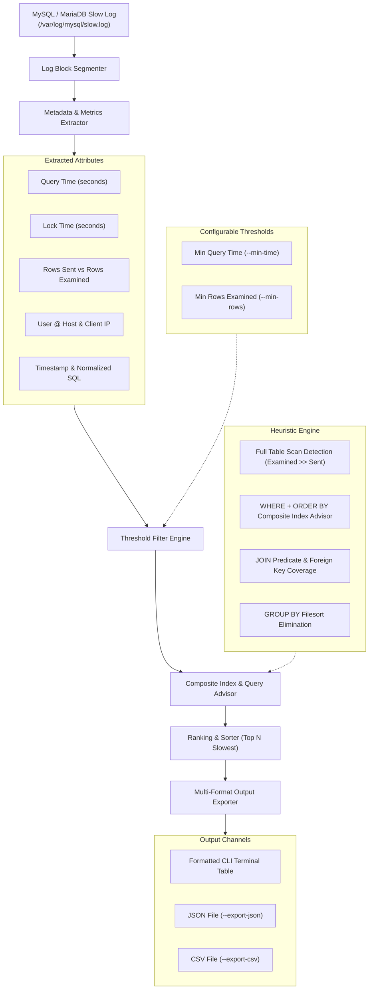

# ⏱️ sql-slow-query-analyser

[](LICENSE)
[](https://mysql.com)
[](https://github.com/MobileConduit/sql-slow-query-analyser/actions)
[](https://python.org)
[](https://github.com/MobileConduit)

High-performance log analyzer parsing multi-gigabyte MySQL and MariaDB slow query logs, aggregating offending queries by execution footprint, applying threshold filters, generating automated composite index recommendations, and exporting reports to JSON and CSV.

---

## 🏗️ Architecture & Analysis Pipeline



---

## ✨ Key Features

- **Multi-Gigabyte Log Streaming:** High-performance chunking parser designed to process massive log files efficiently.
- **Zero External Dependencies:** Built entirely with Python's standard library (`re`, `csv`, `json`, `argparse`, `pathlib`, `unittest`).
- **Composite Index Advisor:** Heuristic rule engine inspecting SQL patterns (table scans, joins, sorting, grouping) to recommend exact index strategies.
- **Configurable Thresholds:** Filter out query noise with fine-tuned minimum query time and examined row counts.
- **Structured JSON & CSV Exports:** Generate automated reports for database audit reviews and automated DevOps pipelines.
- **Full Environment Variable Support:** Configure runtime defaults via `.env` or system environment variables.
- **Automated Test Suite:** Complete unit tests running synthetic slow log patterns across MySQL and MariaDB variants.
- **GitHub Actions CI/CD:** Matrix testing pipeline validating Python 3.10, 3.11, and 3.12.

---

## 🚀 Quick Start

### Installation

Clone the repository:
```bash
git clone https://github.com/MobileConduit/sql-slow-query-analyser.git
cd sql-slow-query-analyser
```

No external pip packages required!

### Basic Usage

Analyze a slow query log:
```bash
python analyser.py --log /var/log/mysql/mysql-slow.log
```

---

## ⚙️ Configuration & Environment Variables

Copy the sample environment file:
```bash
cp .env.example .env
```

| Variable | Description | Default |
|:---|:---|:---|
| `SLOW_LOG_PATH` | Path to MySQL/MariaDB slow query log file | `/var/log/mysql/mysql-slow.log` |
| `MIN_QUERY_TIME` | Minimum query duration in seconds to report | `1.0` |
| `MIN_ROWS_EXAMINED` | Minimum examined rows to report | `1000` |
| `TOP_N` | Number of top offending queries to output | `10` |
| `EXPORT_FORMAT` | Default output format (`table`, `json`, `csv`) | `json` |
| `EXPORT_PATH` | Target file path for exported reports | `slow_queries_report.json` |

---

## 🖥️ CLI Usage & Flags

```bash
python analyser.py [options]
```

### Options Reference

| Flag | Short | Description | Example |
|:---|:---:|:---|:---|
| `--log` | `-l` | Path to slow query log file | `-l /var/log/mysql/slow.log` |
| `--min-time` | `-t` | Min query time threshold in seconds | `-t 2.5` |
| `--min-rows` | `-r` | Min rows examined threshold | `-r 50000` |
| `--top` | `-n` | Top slowest queries to display | `-n 10` |
| `--export-json` | | Path to export findings as JSON | `--export-json report.json` |
| `--export-csv` | | Path to export findings as CSV | `--export-csv report.csv` |
| `--format` | | Console output format (`table`, `json`, `csv`) | `--format json` |
| `--help` | `-h` | Show help message and exit | `-h` |

### Examples

**Filter queries slower than 2.0s with over 50,000 examined rows and export to CSV:**
```bash
python analyser.py -l /var/log/mysql/mysql-slow.log -t 2.0 -r 50000 --export-csv critical_queries.csv
```

**Export top 20 slowest queries directly to JSON for dashboard ingestion:**
```bash
python analyser.py -l /var/log/mysql/mysql-slow.log -n 20 --export-json slow_queries.json
```

---

## 🧪 Automated Testing

Run the automated test suite using Python's built-in `unittest` runner:

```bash
python -m unittest discover -s tests -p "test_*.py" -v
```

The test suite validates:
- Ingestion of synthetic MySQL / MariaDB slow query log records
- Timestamp, user host, and multi-line SQL statement extraction
- Descending execution time ordering
- `min_time` and `min_rows` threshold filtering
- Recommendation engine rules (full table scans, composite indexes, foreign key joins)
- JSON and CSV file persistence and integrity
- `.env` variable configuration loader

---

## 👤 Author & Maintainer

**Eng. MHD. Shadi AL-Hasan**  
- **Role:** Executive CTO & Enterprise Solutions Architect  
- **Email:** [mhd.shadi.alhasan@gmail.com](mailto:mhd.shadi.alhasan@gmail.com)  
- **Phone / WhatsApp:** [+963934005922](tel:+963934005922)  
- **Location:** Damascus, Syria  
- **GitHub:** [MobileConduit](https://github.com/MobileConduit)  

---

## 📄 License

This project is licensed under the MIT License - see the [LICENSE](LICENSE) file for details.  
Copyright (c) 2026 **MHD. Shadi AL-Hasan**. All rights reserved.
